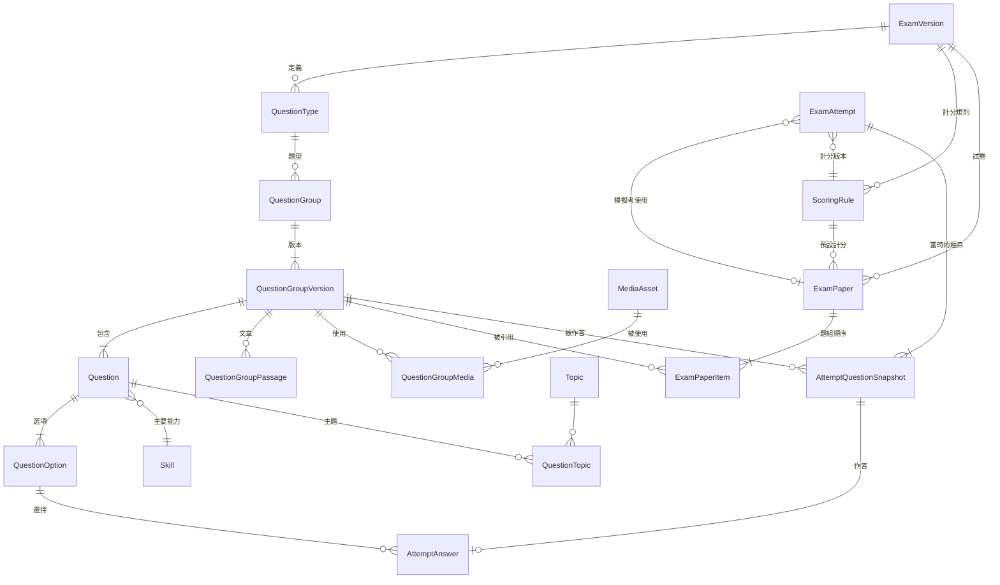

# Phase 2 資料庫設計（F2-02 題庫資料模型）

- 狀態：**已確認並實作**（2026-11-16）；實作時的調整標示於各節
- 依據：[00-decisions.md](00-decisions.md)、ADR [0007](../decisions/0007-shared-exam-attempt.md)、[0008](../decisions/0008-question-group-versioning.md)
- 範圍：只建立資料模型、Domain 規則、EF Core 設定、Migration 與測試；API 與畫面屬於 F2-03 之後。

## 1. TOEIC L&R 題型（實作前查證）

| Part | 題型 | 題數 | 題組結構 | 選項 | 媒體 |
|---|---|---|---|---|---|
| 1 | Photographs | 6 | 1 題 / 組 | 4（只播音，不顯示文字） | 照片 + 音檔 |
| 2 | Question-Response | 25 | 1 題 / 組 | **3**（只播音） | 音檔 |
| 3 | Conversations | 39 | 13 組 × 3 題 | 4（題目與選項印出） | 音檔；部分組附圖表 |
| 4 | Talks | 30 | 10 組 × 3 題 | 4 | 音檔；部分組附圖表 |
| 5 | Incomplete Sentences | 30 | 1 題 / 組 | 4 | — |
| 6 | Text Completion | 16 | 4 組 × 4 題 | 4 | — |
| 7 | Single Passages | 29 | 10 組，每組 2～4 題 | 4 | 可附圖 |
| 7 | Multiple Passages | 25 | 2 組雙篇 + 3 組三篇，每組 5 題 | 4 | 可附圖 |

聽力約 45 分鐘、閱讀 75 分鐘，各 100 題。查證來源：IIBC（日本 TOEIC 主辦單位）測驗格式頁、ETS 2018 題型更新說明。Part 7 拆成兩種題型，方便練習篩選與成績分析；兩者在成績中合併為 Part 7。

## 2. ERD

使用者（`AspNetUsers`）與 `QuestionGroup`（建立者）、`MediaAsset`（上傳者）、`ExamAttempt`（作答者）相連，圖中省略。

## 3. 模組與資料表

Domain 新增兩個模組資料夾：`QuestionBank`（題庫）與 `Attempts`（作答）；試卷與計分規則放在既有的 `Exams`。

### 3.1 參考資料（`HasData`，固定 Guid）

| 資料表 | 主要欄位 | 說明 |
|---|---|---|
| `QuestionTypes` | `Code`（唯一）、`ExamVersionId`、`Part`、`Section`（Listening / Reading）、`MinQuestions`、`MaxQuestions`、`OptionCount`、`RequiresAudio`、`RequiresImage`、`ShowsQuestionText`、`ShowsOptionText`、`SortOrder` | 第 1 節的 8 種題型；題組驗證規則從這裡讀取 |
| `Skills` | `Code`（唯一）、`Name`、`Section`、`SortOrder` | 例如：文法、字彙、主旨、細節、推論、說話者意圖、圖表整合、多篇整合、同義改寫 |
| `Topics` | `Code`（唯一）、`Name`、`SortOrder` | 例如：辦公室、人事、行銷、財務、採購、製造、旅遊、餐飲、住宿、活動、科技、健康 |
| `ScoringRules` | `Code` + `Version`（唯一）、`ExamVersionId`、`Kind`（`RawCount`）、`ParametersJson`、`IsDefault` | 先建一筆「TOEIC-LR 答對題數 v1」；預留非官方預估分數（`Kind` 擴充） |

參考資料只能由 Migration 修改，不提供 API 編輯。

### 3.2 題庫

**`QuestionGroups`**（題組的固定身分，不保存內容）

| 欄位 | 型別 | 說明 |
|---|---|---|
| `Id` | `uniqueidentifier` | `Guid.CreateVersion7` |
| `Code` | `nvarchar(20)` 唯一 | 例如 `P5-0001`，給人辨識與抽查 |
| `QuestionTypeId` | FK → `QuestionTypes`（Restrict） | 建立後不可變更 |
| `CreatedByUserId` | FK → `AspNetUsers`（Restrict） | |
| `CreatedAtUtc` | `datetime2` | |
| `PublishedVersionNumber` | `int` NULL | 目前已發布的版本號；發布與停用都會更新題組本身 |
| `RowVersion` | `rowversion` | 發布、停用的並行控制：同一題組同時發布只有一個成功 |

**`QuestionGroupVersions`**（題組的內容版本；見 ADR 0008）

| 欄位 | 型別 | 說明 |
|---|---|---|
| `Id` | `uniqueidentifier` | |
| `QuestionGroupId` | FK → `QuestionGroups`（Restrict） | |
| `VersionNumber` | `int` | (`QuestionGroupId`, `VersionNumber`) 唯一 |
| `Status` | `nvarchar(20)` | `Draft` → `Published` → `Retired`；不可倒退 |
| `Transcript` | `nvarchar(max)` NULL | 聽力腳本；作答中不回傳給學生 |
| `Explanation` | `nvarchar(max)` NULL | 題組層級的解析或翻譯 |
| `Source` | `nvarchar(20)` | 目前只允許 `Original`（原創）；禁止匯入官方或市售題目 |
| `AuthorNote` | `nvarchar(1000)` NULL | 出題與審核備註，不給學生看 |
| `ContentHash` | `char(64)` | 發布時計算，便於比對兩個版本是否相同 |
| `CreatedAtUtc`、`CreatedByUserId` | | |
| `PublishedAtUtc`、`PublishedByUserId` | NULL | |
| `RetiredAtUtc`、`RetiredByUserId` | NULL | |
| `RowVersion` | `rowversion` | |

- 每個題組最多一個 `Draft`：篩選唯一索引（`WHERE Status = 'Draft'`）。
- 每個題組最多一個 `Published`：由 Domain 保證，並以 `QuestionGroups.RowVersion` 讓並行發布只有一個成功。發布新版本時，舊的 `Published` 版本在同一次儲存中改為 `Retired`；這兩筆 UPDATE 的執行順序不固定，因此**不**使用篩選唯一索引（實作時調整，2026-11-16）。

**`QuestionGroupPassages`**：Part 6、7 的文章。`Id`、`GroupVersionId`（Cascade）、`SortOrder`（(`GroupVersionId`, `SortOrder`) 唯一）、`Title`（`nvarchar(200)` NULL，例如「E-mail」「Invoice」）、`Body`（`nvarchar(max)`）。單篇文章只有一列；Part 7 雙篇、三篇各有 2、3 列，題型規則會檢查篇數。

**`Questions`**

| 欄位 | 型別 | 說明 |
|---|---|---|
| `Id` | `uniqueidentifier` | |
| `GroupVersionId` | FK → `QuestionGroupVersions`（Cascade，只在刪除草稿時發生） | |
| `Number` | `int` | 題組內順序 1..n；(`GroupVersionId`, `Number`) 唯一 |
| `Stem` | `nvarchar(1000)` NULL | Part 1、2 不顯示題幹（腳本在 `Transcript`） |
| `SkillId` | FK → `Skills`（Restrict） | 主要能力 |
| `IntendedDifficulty` | `nvarchar(10)` | 出題者估計：`Easy` / `Medium` / `Hard`；實際答對率另計（滿 30 次作答才顯示） |
| `Explanation` | `nvarchar(max)` | 發布時必填 |

**`QuestionOptions`**：`Id`、`QuestionId`（Cascade）、`Label`（A–D，(`QuestionId`, `Label`) 唯一）、`Text`（`nvarchar(500)`；Part 1、2 為腳本內容，作答中不顯示）、`IsCorrect`。「恰好一個正確答案」由 Domain 在發布時檢查；草稿更換正確答案會在同一次儲存內更新兩個選項，同樣因執行順序不固定而**不**使用篩選唯一索引（實作時調整）。

**`QuestionTopics`**：(`QuestionId`, `TopicId`) 複合主鍵；Question 端 Cascade、Topic 端 Restrict。

**`QuestionGroupMedia`**：`Id`、`GroupVersionId`（Cascade）、`MediaAssetId`（Restrict）、`Purpose`（`Audio` / `Photo` / `Graphic`）、`SortOrder`、`AltText`（圖片必填，無障礙用）。(`GroupVersionId`, `MediaAssetId`) 唯一。每個版本最多一個 `Audio` 由 Domain 保證（更換音檔是同一次儲存內的刪除加新增，不使用篩選唯一索引）。

**`MediaAssets`**（上傳後內容不可變）

| 欄位 | 說明 |
|---|---|
| `Kind` | `Image` / `Audio` |
| `ContentType` | 依檔頭判定後的實際類型（JPEG、PNG、WebP、MP3、M4A） |
| `SizeBytes`、`Sha256`（`char(64)`） | (`Kind`, `Sha256`) 唯一，重複上傳時重用 |
| `StorageKey` | `IMediaStorage` 的不透明鍵，不是公開路徑 |
| `OriginalFileName` | 清理過的原始檔名，只供管理者辨識 |
| `Width`、`Height` | 圖片 |
| `DurationMs` | 音檔，由管理者上傳時瀏覽器讀取 |
| `SourceType` | `Original`（原創）/ `OwnPhoto`（開發者自行拍攝）/ `Licensed`（有授權） |
| `SourceDescription`、`License` | 必填 |
| `UploadedByUserId`、`UploadedAtUtc` | |

存取控制（草稿只給管理者、已發布題組依練習或考試快照授權）在 F2-03 的媒體 API 實作。

### 3.3 試卷與計分

**`ExamPapers`**：`Id`、`ExamVersionId`（Restrict）、`Code`（唯一）、`Title`、`Kind`（`FullTest`：200 題 / `ReadingOnly`：Part 5–7 共 100 題）、`Status`（`Draft` / `Published` / `Retired`）、`ReadingTimeLimitSeconds`（4500）、`ListeningDurationMs`（發布時由音檔總長計算；`ReadingOnly` 為 NULL）、`DefaultScoringRuleId`（Restrict）、`PublishedAtUtc`、`RowVersion`。

**`ExamPaperItems`**：`Id`、`ExamPaperId`（Cascade，只在刪除草稿試卷時）、`GroupVersionId`（Restrict，必須是 `Published` 版本）、`SortOrder`。(`ExamPaperId`, `SortOrder`) 與 (`ExamPaperId`, `GroupVersionId`) 唯一。發布試卷時檢查各 Part 的題數符合第 1 節。

已發布試卷引用的題組版本即使之後被新版本取代而改為 `Retired`，試卷仍引用原版本，因此考題不會在使用者之間不一致。

### 3.4 作答（見 ADR 0007）

**`ExamAttempts`**

| 欄位 | 說明 |
|---|---|
| `UserId` | FK → `AspNetUsers`（Restrict；帳號刪除另行處理） |
| `Mode` | `Practice` / `MockExam` / `ReadingTest` |
| `ExamPaperId` | 練習為 NULL；模擬考與閱讀測驗必填 |
| `ScoringRuleId` | 開始時決定，之後不變 |
| `Status` | `InProgress` → `Completed`（不可倒退） |
| `CompletionReason` | `Submitted` / `TimedOut` / `Abandoned`（練習放棄） |
| `CurrentSection` | `Listening` / `Reading`；進入閱讀後不能回到聽力 |
| `StartedAtUtc`、`ReadingStartedAtUtc`、`CompletedAtUtc` | |
| `ListeningDeadlineUtc`、`ReadingDeadlineUtc` | 伺服器計算；判斷逾時另加 5 秒寬限 |
| `PracticeCriteria` | `nvarchar(1000)` JSON，記錄練習的篩選條件（Part、能力、主題、題數） |
| `TotalQuestions`、`CorrectCount`、`ListeningCorrect`、`ReadingCorrect` | 完成時寫入，之後不重算 |
| `RowVersion` | 交卷、切換段落、逾時結算的並行控制 |

索引：(`UserId`, `StartedAtUtc` DESC)、(`UserId`, `Status`)、篩選索引 (`Status`, `ReadingDeadlineUtc`) `WHERE Status = 'InProgress'`（背景服務每分鐘掃描過期考試）。

**`AttemptQuestionSnapshots`**（開始作答時建立，之後不可變）：`Id`、`AttemptId`（Cascade）、`Sequence`（1..n，唯一）、`QuestionGroupId`、`GroupVersionId`、`QuestionId`（唯一）、`Part`、`Section`、`CorrectOptionId`（當時的正確答案）。題組與題目 FK 皆 Restrict。`QuestionGroupId` 冗餘保存，用來查「做過的題目」（2c 重複題提示），並建立 (`QuestionGroupId`) 索引。

**`AttemptAnswers`**（每題一列，作答中可更新，完成後不可變）：`Id`、`AttemptId`、`SnapshotId`（唯一，Cascade）、`SelectedOptionId`（NULL = 清除作答；Restrict）、`ClientSequence`（`bigint`，較舊的序號直接忽略，處理多分頁）、`MarkedForReview`、`ElapsedMs`（約略作答時間）、`UpdatedAtUtc`、`IsCorrect`（完成時寫入）。

## 4. 不可變與並行規則

1. **Domain 方法**：只有 `Draft` 版本能修改內容；`Publish()` 檢查題型規則（題數、選項數、恰好一個正確答案、必要媒體、解析）；`Retire()` 只允許從 `Published`。
2. **SaveChanges 防護**（Infrastructure 的 `ImmutableContentInterceptor`）：拒絕修改或刪除「非 `Draft` 版本」的題目、選項、主題、媒體關聯、文章，以及已上傳的 `MediaAsset`、完成後的作答與快照、已發布的試卷項目。即使程式寫錯也不會改到歷史資料。
3. **刪除規則**：只有草稿題組版本與草稿試卷可以刪除；其餘一律 `Restrict`，版本只停用不刪除。
4. **並行控制**：`QuestionGroups`、`QuestionGroupVersions`、`ExamPapers`、`ExamAttempts` 使用 `rowversion`，衝突回傳 409（沿用 Phase 1 處理方式）。同一場作答的存答與交卷以 `ExamAttempts.RowVersion` 序列化。
5. **時間**：所有時間欄位以 `Utc` 結尾，透過既有的 `UtcDateTimeConverter`，時間來源用 `TimeProvider`。
6. **列舉**以字串保存（與 Phase 1 `EmailOutbox` 相同），方便閱讀資料庫與日後擴充。

## 5. F2-02 交付內容

| 類別 | 內容 |
|---|---|
| Domain | 第 3 節實體、狀態轉移與驗證規則；`QuestionTypeRules` 依題型驗證題組 |
| Infrastructure | EF Core Fluent API 設定、`HasData` 參考資料、`ImmutableContentInterceptor`、Migration `AddQuestionBank` |
| Application | `IAppDbContext` 加入新的 `DbSet`（F2-03 起使用） |
| 單元測試 | 各題型驗證、恰好一個正確答案、發布與停用、作答狀態轉移、逾時判斷（含 5 秒寬限）、舊序號忽略 |
| 整合測試 | 從乾淨資料庫建立、參考資料存在、唯一與篩選索引生效、已發布內容無法修改或刪除、rowversion 衝突 |
| 架構測試 | Domain 不相依其他層（沿用既有測試） |

不建立 F2-03 之後的 API、頁面或空介面。

## 6. 尚未決定、留到後續工作包

- 媒體 API 的授權細節與 Range 串流（F2-03）。
- 練習的出題策略（優先未做過的題目、依弱項）（F2-04）。
- 非官方預估分數的換算方式（F2-06，`ScoringRule.Kind` 擴充）。
